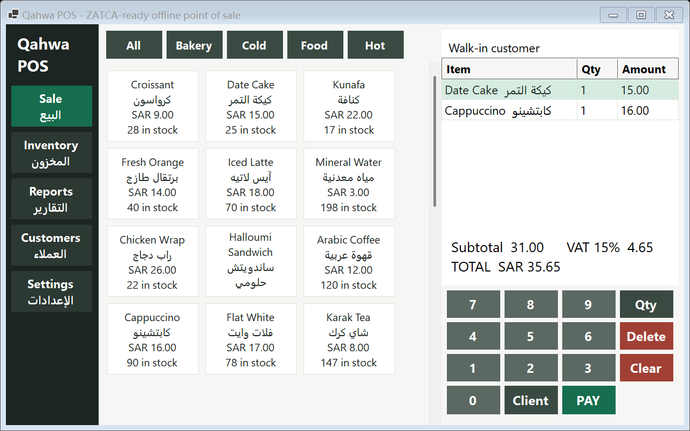
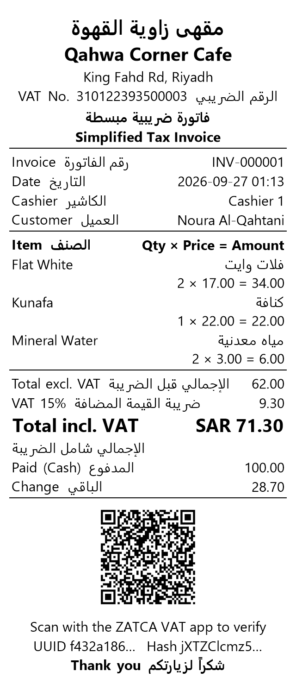
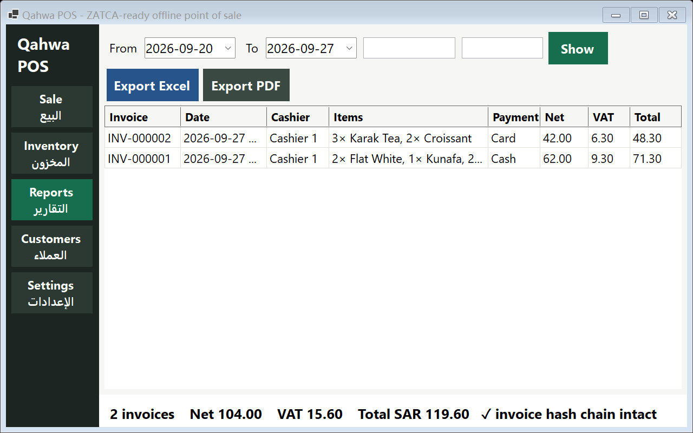
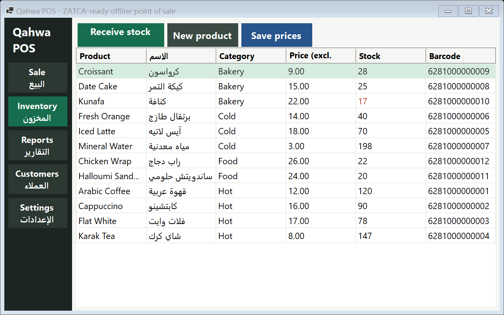

# Qahwa POS: ZATCA-ready offline point of sale (demo build)

A Windows point-of-sale app that runs completely offline and prints Saudi simplified tax invoices with the ZATCA QR code. Built for touch-screen terminals: big tiles, an on-screen keypad and one-tap payment.

| Sale screen | Receipt |
|---|---|
|  |  |

| Reports | Inventory |
|---|---|
|  |  |

## What works in this build

- **Sale:** product tiles by category (English + Arabic names, price, stock), cart, keypad for quantities, attach a customer by phone, cash (with change) or card/mada payment, then print or preview the receipt.
- **ZATCA invoice:** bilingual simplified tax invoice on an 80 mm roll with the Phase 1 QR code (TLV: seller name, VAT number, timestamp, total with VAT, VAT). VAT is 15%, rounded per invoice. The VAT number is validated (15 digits, starts and ends with 3).
- **Ready for Phase 2:** every invoice stores a UUID, a running counter and a hash chained to the previous invoice, starting from ZATCA's documented initial hash. The reports page verifies the chain and flags any edited invoice.
- **Inventory:** real-time stock deduction on every sale, over-selling is blocked, purchase-order entry adds stock and records supplier and cost, price editing, new products.
- **Reports:** filter by date range, product and cashier, totals for net, VAT and gross, export to Excel (CSV with BOM so Arabic opens correctly) or PDF through Windows' built-in PDF printer.
- **Customers:** quick lookup by name or phone, add on the fly from the sale screen, loyalty points (1 point per 10 SAR).
- **Offline:** everything is stored in one SQLite file under `%LOCALAPPDATA%\QahwaPOS`.

## Tested

`ZatcaPos.exe selftest` runs against a fresh database:

```
PASS  net = 2 x 16 + 15 = 47.00
PASS  VAT 15% = 7.05, total = 54.05
PASS  stock deducted (90 -> 88, 25 -> 24)
PASS  loyalty points added (40 + 5)
PASS  QR TLV: seller, VAT number, UTC timestamp, total 54.05, vat 7.05
PASS  first invoice chains from ZATCA's initial PIH
PASS  second invoice number INV-000002 chains to the first
PASS  hash chain verifies
PASS  over-selling blocked
PASS  purchase order adds stock (24 -> 36)
PASS  report filter by product finds 1 sale with Date Cake
PASS  CSV export has header + 2 rows
PASS  tampered invoice detected by the hash chain
ALL CHECKS PASSED
```

## Run it

Download `ZatcaPos.exe` from Releases and double-click. It needs nothing else installed. The demo starts with a café menu, two customers and sample seller details (change them under Settings).

Build from source (Windows, .NET 9 SDK):

```
cd src
dotnet publish -c Release -r win-x64 --self-contained true -p:PublishSingleFile=true -o ../publish
```

## Not in this demo yet

- License-key activation with a key-generation portal.
- Windows installer (MSI or Inno Setup) instead of a single exe.
- ZATCA Phase 2 (UBL XML, cryptographic stamp, CSID onboarding and Fatoora API sync).
- Printer-specific tuning for a given thermal printer model.
